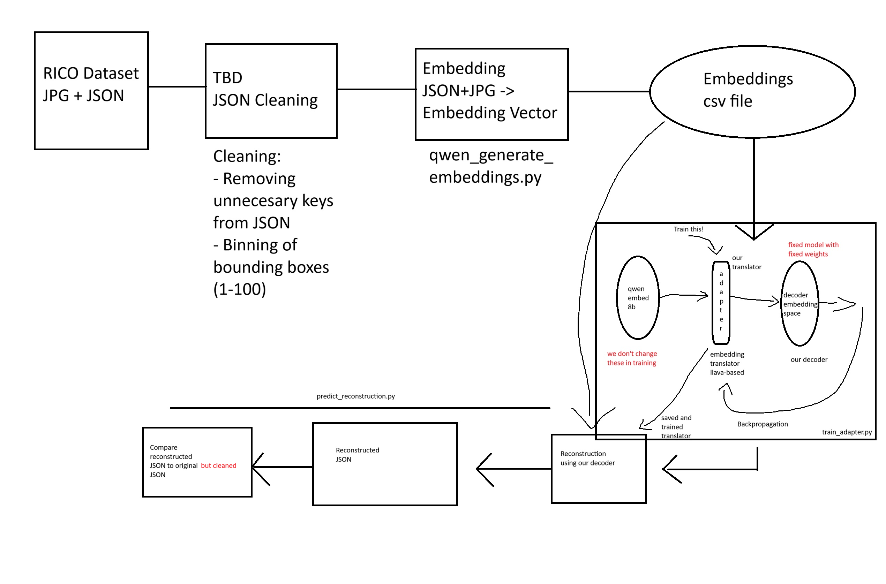

# screen2vec-revisited

Execution Flow:

1. Load RICO-Dataset
2. Clean RICO-Dataset
    - Remove unnecessary keys from JSON.
    - Apply binning of bounding boxes (1-100%).
    - Implemented in: `utils.py::process_json_file()`.
3. Create Embeddings (`1_qwen_generate_embeddings.py`).
4. Train the Adapter!
    - To translate the encoders (qwen-embed-8b) embedding space to the decoder embedding space.
    - File: `2_train_adapter.py`.
5. Predict a reconstructed UI from validation-set embeddings and save the reconstructed JSON (`3_json_reconstruction.py`).
6. Compare the reconstructed JSON to original but cleaned JSON.
7. Calculate some metric over all elements.

## Important Information

- All embeddings and adapter training needs to be redone, when the JSON processing code is touched!

## Process Sketch

