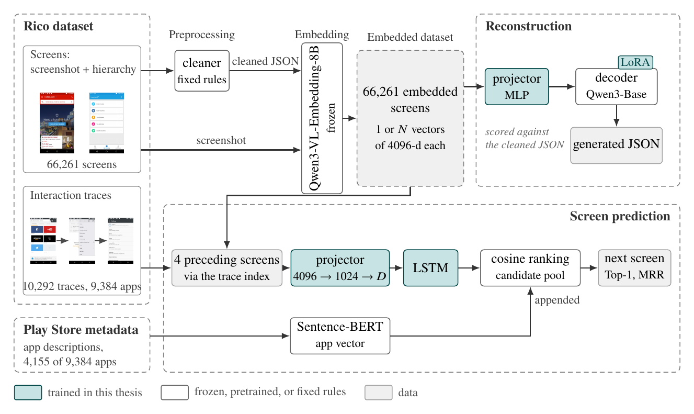
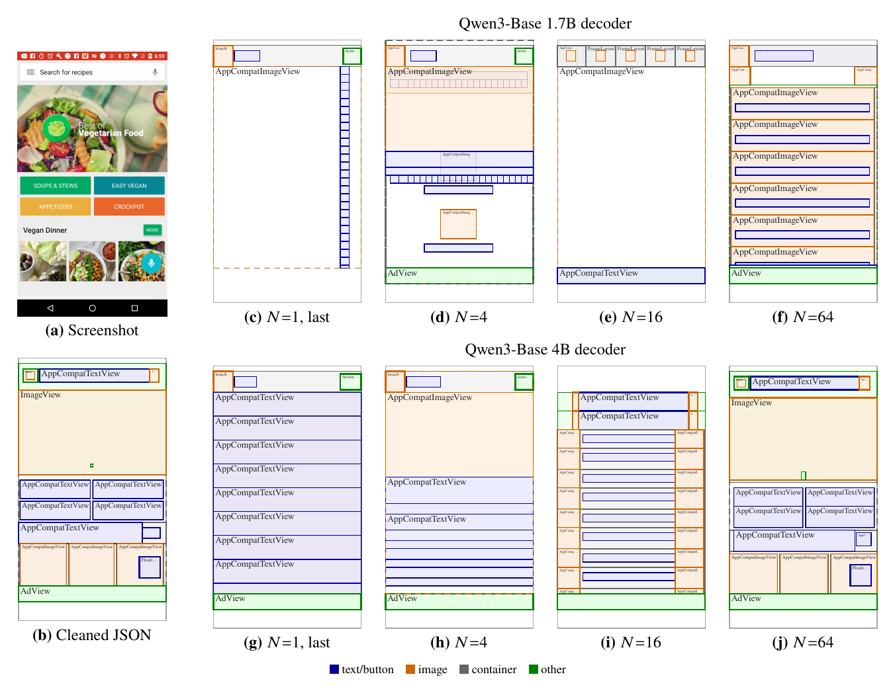

# Modernizing Screen2Vec

Code and recorded results for the bachelor's thesis

> **Modernizing Screen2Vec: Using Vision-Language Models to Generate Novel User
> Interfaces Based on Their Semantic Embeddings**
> Yigit Baysoyu, TU Dortmund, 2026.
> Examiners: Prof. Dr. Sven Mayer and Prof. Dr. Jonathan Liebers.

**[Read the thesis (PDF)](thesis/thesis.pdf)**



*The pipeline. Every Rico screen is cleaned and embedded once by the frozen
embedder; one track reconstructs the cleaned hierarchy from the vectors, the other
predicts the next screen of a trace.*

## What the thesis does

Screen2Vec (Li et al., CHI 2021) learns embeddings of mobile GUI screens from the
text and layout of their components. The thesis asks whether a general-purpose
vision-language embedding model, used without further training, can take its
place, and what its vectors hold of a screen.

Every screen of the Rico dataset is embedded once by the frozen
`Qwen3-VL-Embedding-8B`, from its screenshot together with its cleaned view
hierarchy. Two tracks then read those vectors:

- **Reconstruction.** An adapter (a projector plus LoRA weights on a Qwen3-Base
  decoder) writes the cleaned hierarchy back out of the vectors. Fifteen adapters
  are trained: three decoder sizes times five representations.
- **Screen prediction.** A projector and an LSTM predict the next screen of an
  interaction trace, evaluated with a re-implementation of Screen2Vec's released
  evaluator.

## Results

- **One vector gives a rough outline.** From a single vector, every decoder size
  reaches an unordered class F1 of about 0.330.
- **Sixty-four vectors give most of the hierarchy.** The largest decoder reaches
  an unordered class F1 of 0.804 on the validation split, at the cost of more
  storage than the original data.
- **Screen prediction.** The small network reaches a Top-1 accuracy of 0.118,
  against 0.061 for the best result printed in the Screen2Vec paper. The two
  setups differ in several ways, so the gain cannot be assigned to one cause.
- **Width.** Retrieval is best at 256 dimensions, about a third of the width of
  the Screen2Vec vector.

Reconstruction scores are the scores after JSON repair and loop collapse.



*One validation screen (a), its cleaned hierarchy (b), and what the 1.7B decoder
(c–f) and the 4B decoder (g–j) write back from 1, 4, 16 and 64 vectors.*

## Where each thesis result comes from

| Thesis | Code | Recorded result |
|---|---|---|
| Section 4.2, cleaning rules; Figure 4.2 | `utils.py` | – |
| Section 4.2, trace index (66,157 of 66,261 screens matched) | `trace_index.py`, `0_build_trace_index.py` | `trace_layout_index.csv`, `trace_layout_index_dropped.csv`, `trace_layout_index.meta.json` |
| Section 4.2, trace statistics | `rico-metrics.ipynb` | recorded in the notebook |
| Section 4.3, embedding and pooling | `1_qwen_generate_embeddings.py` | not included (see below) |
| Section 4.4 and Table 4.1, adapter and training settings | `2_train_adapter.py`, launched by `2_train_adapter_amplitude.sh` through `hpc/_hpc5_start_adapter_and_reconstruction.py` and `hpc/_hpc7_qwen3_4b_64x4096_all_in_one.py` | – |
| Section 4.4, decoding | `3_json_reconstruction_par.py` | `run_manifests/` (one file per run: adapter, embeddings, token limit, date); the decoded outputs are not included (see below) |
| Table 4.2, metrics, JSON repair and loop collapse | `reconstruction_metrics.py`, `repair_rescore.py` | – |
| Section 4.4, allowlist and disallowlist (named `whitelist` and `blacklist` in the code and data files) | `screen_observability.py`, `_results_screen_observability.ipynb` | `screen_observability.csv`, `screen_observability.meta.json`, `graphics/screen_observability/` |
| Tables 5.1, 5.2, 5.3, A.1, A.2; Figures 5.1, 5.2 | `_results_reconstruction.ipynb`, `_results_reconstructions_boxplots.ipynb` | `graphics/qwen3_repaired_boxplot_metrics.csv.gz` (the repaired per-screen scores of all fifteen adapters), `graphics/qwen3_adapter_validation_ids.csv.gz` (the validation split) |
| Figure 5.3, example screen | `_results_reconstructions_viz.ipynb` | recorded in the notebook |
| Section 4.5 and Table 4.3, projector and LSTM | `9_train_joint.py` | training logs in the four `_results_sequence_prediction_*.ipynb` |
| Section 4.5, app text and app vector | `gplay_scraper.py`, `6_generate_app_context_embeddings.py` | – |
| Tables 4.4 and 5.4, strict and *n*-back protocols | `4_evaluate_screen_prediction.py` | `_results_sequence_prediction_s2v_strict.ipynb`, `_results_sequence_prediction_nback{1,2,3}.ipynb` |
| Figure 5.4 and Table A.3, dimension sweep | `4_sweep_embedding_dimensions.py`, `_run_dimension_sweep.sh`, `_results_dimension_sweep.ipynb` | `dimension_sweep/results_strict.json`, `dimension_sweep/sweep_results_strict.csv` |
| Section 4.6, comparison with the original evaluator | `third_party/screen2vec/` | – |

Table A.4 (storage sizes) was measured on the run machine and has no file here.

## Running it

```bash
pip install -r requirements.txt
python -m unittest tests.function_tests -v      # from the repository root
```

`requirements.txt` points at the CUDA 12.4 build of PyTorch. The tests need no
GPU and no Rico download. Every script is run from the repository root, in this
order:

1. `0_build_trace_index.py` joins traces and layout ids (needed by every trace stage).
2. `1_qwen_generate_embeddings.py` embeds every screen with the frozen
   Qwen3-VL-Embedding-8B, as 1 or *N* pooled 4096-dimensional vectors.
3. **Reconstruction:** `2_train_adapter.py`, then `3_json_reconstruction_par.py`,
   then `repair_rescore.py`.
4. **Screen prediction:** `9_train_joint.py`, then
   `6_generate_app_context_embeddings.py`, then `4_evaluate_screen_prediction.py`.
   `_run_table3_pipeline2.ps1` holds these three commands; the reported runs add
   `--strict` or `--nback <n>` to training and evaluation.
5. **Dimension sweep:** `4_sweep_embedding_dimensions.py` wraps the three
   screen-prediction steps; `_run_dimension_sweep.sh` holds its commands.

The numbers in the file names are historical and have gaps; earlier variants are
in the commit history. The launchers in `hpc/` generate Slurm jobs for one
specific cluster and are kept as the record of how the runs were started.

## What is not in the repository

- **Rico.** The scripts expect the dataset next to the repository at
  `../rico-data/` (`data/layouts/`, `data/traces/filtered_traces/`,
  `data/play_store_metadata/`) and the embedder at
  `../rico-data/models/Qwen3-VL-Embedding-8B`. This is the layout of the data
  repository used for the runs, <https://git.uni-due.de/sgjolieb/rico-data>.
  Rico itself is published at <http://interactionmining.org/rico>. Five example
  screens for the tests are in `data/rico-examples/`.
- **Embeddings, adapter weights and raw decoder outputs.** They are too large
  for a repository (the embeddings alone are between 417 MB and 29.8 GB per
  representation). The per-screen scores computed from the decoder outputs are
  included, see the table above.

## Limits of reproducibility

Section 4.7 of the thesis states what could not be recorded or repeated exactly.
Two points concern only the code:

- `requirements.txt` pins no library versions. `requirements-recorded.txt` lists
  the versions installed on the development machine.
- The default `lm_model_id` in `2_train_adapter.py` is an older decoder; the
  reported runs passed `--lm_model_id Qwen/Qwen3-{0.6B,1.7B,4B}-Base` from the
  launchers.

## Credits

This repository continues the project repository shared with Prof. Dr. Jonathan
Liebers, who supervised the thesis and wrote a large part of the code. The
commit history is kept in full and shows who contributed what.

The folder `third_party/screen2vec/` contains the original Screen2Vec code by
Li, Popowski, Mitchell and Myers under its Apache-2.0 licence; see the
[`NOTICE.md`](third_party/screen2vec/NOTICE.md) there.
